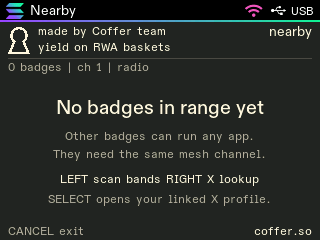

# Nearby by Coffer

Find nearby Solana badges, open their owners' public X profiles, and follow a
warmer/colder radio-signal indicator. Other people do not need to open Nearby or
X Dex: discovery uses Solana OS's badge presence messages on the same mesh channel.
Signal strength is a rough proximity clue, not GPS or an exact distance.

Made by Coffer team. [yield on RWA baskets here → coffer.so](https://coffer.so)
· [@coffer_so](https://x.com/coffer_so)

Version **1.0.0** is installed over USB with all nine file hashes verified.
[Solana OS App Store listing](https://solana.com/breakpoint/badge/apps/app?id=nearby):
**live**, free, in **Social**, version **1.0.0**.
[Validation results and remaining device checks](docs/validation.md).



Physical badge capture: empty nearby list, with no personal profile shown.

## Install from the App Store

Open **App Store → Social → Nearby**
on the badge, or search for **Nearby**, and SELECT **Install**. It runs from
**Apps → Nearby**. A microSD card, working Wi-Fi and Solana OS 2.0+ are needed.
The shareable listing is linked above. USB installation is available below.

## Use

Use UP/DOWN to choose a badge and SELECT to open its profile. LEFT scans both
radio bands and listens on the channel with the most badges; RIGHT opens a
manual X-handle lookup. SELECT on an empty list opens your own profile.
In a profile, LEFT/RIGHT change tabs and UP/DOWN scroll. SELECT refreshes profile
data; on the links tab it switches between text and QR, where UP/DOWN choose
the link. CANCEL returns to the list; rear HOME exits.
Public profiles require a working Wi-Fi/server connection. Configure Wi-Fi in
Solana OS's native Wi-Fi app; credentials belong to OS settings, never this bundle.
The OS shares one radio between mesh discovery and Wi-Fi.

The app requests only `mesh`, `profile` and `http`. HTTP hosts are
`api.fxtwitter.com` and `wsrv.nl`. Public profile details and avatars are loaded
at runtime; test fixtures contain synthetic data only. See
[data and radio discovery](docs/data-and-radio.md) for identity resolution,
external services, channel discovery and RSSI limits.

## Build and check

Install Python 3.10+ and Lua 5.5, then clone and check the source:

```sh
git clone git@github.com:coffer-so/nearby-solana-badge.git
cd nearby-solana-badge
python3 tools/check.py --lua lua5.5
python3 tools/package.py
```

The package is `dist/nearby-1.0.0.zip`; the filename follows `app/app.json`.
Only the nine allowlisted app files ship, including `license.txt`. README, tests, research, logs and
developer captures remain outside the upload. The source guard rejects unknown
files, symlinks, mismatched permissions/hosts and credential-like literals.
Packaging uses fixed ZIP timestamps and file order for byte-identical rebuilds.

For the badge's 32-bit number precision, build official Lua with
`MYCFLAGS=-DLUA_32BITS=1` and pass that interpreter to `--lua`.
The check runs model, social, GIF, network, text and app specs plus Python
packaging/uploader tests. Tests cover signal/proximity calculations, profiles, image decoding, text,
app lifecycle and guarded upload. They do not open a serial port or use real
profile/face fixtures.

## USB installation

Requires [uv](https://docs.astral.sh/uv/), a microSD card and the Solana OS
ESP32-C5 badge. These commands change only the app with ID `nearby`:

```sh
uv run tools/badge.py info
uv run tools/badge.py upload app --run
uv run tools/badge.py mem
```

The helper auto-detects one CH340/USB-serial device. If more than one is attached,
pass `--port` explicitly. It checks the board, refuses to overwrite a different
owner's app, uploads changed files with the OS receiver and verifies every
installed SHA-256 before launching. It never flashes or replaces firmware.
Opening a CH340 port can reset the board; close competing serial monitors first.

For an authorised Store release, upload the tested ZIP through
[Submit an app](https://solana.com/breakpoint/badge/apps/submit), keep app ID
`nearby`, and confirm the resulting review/listing status before describing it as
published.

## Modify

| File | Purpose |
|---|---|
| `app/main.lua` | Physical controls and UI |
| `app/model.lua` | Bounded nearby state and signal calculations |
| `app/net.lua` | Public-profile requests and radio/network coordination |
| `app/social.lua`, `app/gif.lua` | Public social metadata and bounded image decoding |
| `app/text.lua` | Text cleanup and layout helpers |
| `app/app.json` | Stable ID, version, permissions and HTTP hosts |
| `tools/guard.py` | The exact upload allowlist and source/size checks |

The combined application is GPL-2.0-or-later; some individual helper modules are
MIT as marked in their source headers. See [LICENSE](LICENSE), also distributed as `app/license.txt`. Coffer branding retains the team's rights; see
[asset attribution](docs/assets.md). [Platform notes](docs/platform.md) link the
official OS APIs and console source.
