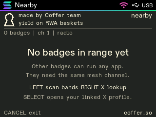

# Validation — Nearby 1.0.0

## Host checks

The final host check passed the source guard and these regression suites:

| Suite | Passed checks |
|---|---:|
| Model | 171 |
| Social | 199 |
| GIF decoder | 847 |
| Network | 17 |
| Text | 815 |
| App | 29,631 |
| Python packaging and uploader | 27 |

Run the same checks from the repository root:

```sh
python3 tools/check.py --lua lua5.5
```

Pass a Lua 5.5 interpreter built with `MYCFLAGS=-DLUA_32BITS=1` to `--lua`
to check the badge's number precision. Fixtures are synthetic; host tests do not
open the USB port or contact real profiles.

## Physical badge

The USB installation verified SHA-256 for all nine app files, totalling
56,218 bytes. Device counters reported:

| Counter | Observed |
|---|---:|
| Lua heap | 136,220 / 6,291,456 bytes |
| Peak callback instructions | 11,934 / 200,000 |
| Reported residual | 0 |
| Last error | none |



The captured empty list contains no personal profile or device identifier.
It confirms launch and the list UI, rather than discovery of another badge.

## Live SDK and remaining device limits

The requested Wi-Fi network was not found during native OS scans. A complete
public-profile and avatar lookup on the physical badge remains pending a
working Wi-Fi connection. The real Store emulator SDK resolved the signed-in linked X handle, loaded its public avatar and biography without API keys, and rendered the website QR. The keyless provider is external and can fail or rate limit requests. No personal profile response, avatar or encounter data is included in this repository.

No second physical badge was available. Peer discovery, warmer/colder trends,
RSSI smoothing and invalid/bridged peer handling were checked with synthetic
fixtures; real two-badge proximity behaviour has not been measured.

Deterministic release ZIP: 21,638 bytes; SHA-256
`a04c7f50bff7e1a0c32c599c3cf4b26a0a4310f2c1542ad058e400ee49e4dd6a`.

Version 1.0.0 passed the automatic Store check on 16 November 2026. The listing
reports “Listed: anyone can find it in the store”, category Social, free.
[Nearby in the Solana OS App Store](https://solana.com/breakpoint/badge/apps/app?id=nearby).
